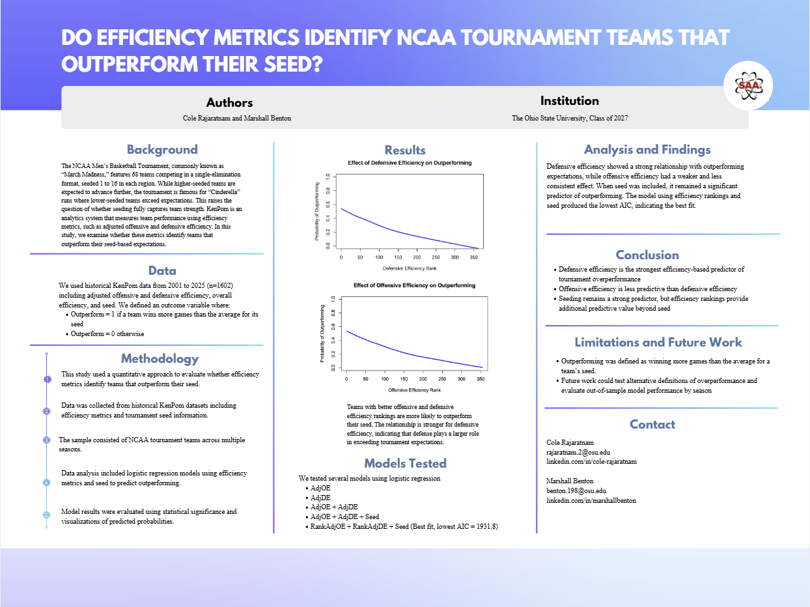

# Do Efficiency Metrics Identify NCAA Tournament Teams That Outperform Their Seed?

**Conference research by Cole Rajaratnam and Marshall Benton · The Ohio State University · 2026**

## The question

March Madness is known for upsets. We wanted to understand whether a team's offensive and defensive efficiency could help identify teams likely to win more games than their tournament seed would suggest.

## What we did

We analyzed **1,602 NCAA Tournament team observations from 2001–2025**, using historical KenPom statistics and tournament results.

- Calculated the average number of tournament wins for each seed.
- Classified a team as **outperforming** if it won more games than the historical average for its seed.
- Built and compared five **logistic regression** models using offensive efficiency, defensive efficiency, rankings and seed.
- Examined the model results and graphed the relationship between efficiency rankings and the model's fitted probabilities.

The repository also includes an earlier **linear regression analysis of tournament wins**. The logistic regression analysis is the one featured in our conference poster that was ultimately presented.

## Findings

- **Defensive efficiency was more strongly associated with outperforming seed expectations** than offensive efficiency in the models we tested.
- **Seed still mattered.** Efficiency rankings provided additional information beyond tournament seed.
- The model using **offensive efficiency rank, defensive efficiency rank and seed** had the lowest AIC of the five logistic regression models tested (**1931.8**).

These are statistical associations, not proof that a team's efficiency causes it to exceed expectations. The analysis did not evaluate how well the models would predict results in a new tournament season.

## Files

| File | Purpose |
| --- | --- |
| [`poster/conference_poster.png`](poster/conference_poster.png) | Poster presented at the conference |
| [`analysis/logistic_regression.Rmd`](analysis/logistic_regression.Rmd) | Main analysis used for the poster |
| [`analysis/exploratory_regression.Rmd`](analysis/exploratory_regression.Rmd) | Earlier analysis of tournament wins |
| [`results/logistic_regression_results.pdf`](results/logistic_regression_results.pdf) | Original model output and figures |
| [`results/exploratory_regression_results.pdf`](results/exploratory_regression_results.pdf) | Output from the earlier analysis |
| [`data/README.md`](data/README.md) | Data source and instructions |

## Data and running the code

The analysis uses historical statistics from [KenPom](https://kenpom.com/). **The dataset is not included** because KenPom restricts redistribution of its data. You can still review the R code, results and poster without it.

To reproduce the analysis with a copy of the dataset you are authorized to use:

1. Place the CSV in `data/` and name it `kenpom_tournament_data.csv` (see [data instructions](data/README.md)).
2. Open `analysis/logistic_regression.Rmd` in RStudio.
3. Knit the document, or run its code chunks. The original outputs are preserved in `results/`.

The code uses base R functions including `glm()`, `lm()`, `aggregate()`, and `lowess()`.

**Validation:** I successfully ran the logistic regression analysis in RStudio using the original dataset. The analysis generated the expected results, including the final model's AIC of 1931.774, matching the original conference research.

## Limitations

- "Outperforming" means winning more games than the historical average for a team's seed. Other definitions could produce different results.
- The findings describe the historical data analyzed. We did not test predictions on a separate tournament season.
- The plotted lines summarize fitted values from the models; they should not be interpreted as showing the effect of changing a single variable while keeping everything else fixed.

## Credits

Research and conference poster: **Cole Rajaratnam and Marshall Benton**, The Ohio State University. KenPom statistics belong to their original source and are cited here for research purposes.
